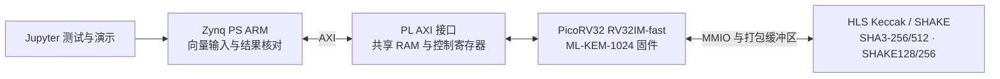

# 后量子密码软硬件协同加速系统

**ML-KEM-1024 · PYNQ-Z2 · RISC-V + Keccak/SHAKE HLS**

本项目在 PYNQ-Z2 上实现 ML-KEM-1024 密钥生成、封装、解封装和密钥检查，以 PicoRV32 RV32IM-fast 处理器执行算法与控制流程，以 HLS 实现 Keccak/SHAKE 运算服务。系统通过 AXI 连接 Zynq PS 与 PL，在 Jupyter 中完成数据输入、固件切换、结果校验及性能展示，为资源受限平台的后量子密码部署提供可复用实现。

**本仓库以 K4 工程本身为根目录。** HLS、RTL、固件、板上发布包、验证数据和构建脚本均在本仓库内，克隆后即可按下列两条路径复现。

## 实板结果

2026-10-23，在同一块 PYNQ-Z2、同一 bitstream、100 MHz 时钟、128 KiB RAM 和 32 KiB 栈条件下，切换 CPU-only 与 CPU + Keccak 固件，完成配对验证。CPU-only 组在 PL 内的 RV32IM-fast 处理器上执行软件 FIPS 202，加速组由相同处理器调用 Keccak 硬件服务；PS ARM 负责输入、控制与结果收集。

| 指标 | CPU-only | CPU + Keccak | 加速比 |
|---|---:|---:|---:|
| 官方测试记录 | 145/145 | 145/145 | — |
| API 周期总和 | 1,699,293,290 | 446,852,439 | **3.802806×** |
| API 时间，100 MHz | 16.992932900 s | 4.468524390 s | **3.802806×** |
| PS 整批墙钟时间 | 22.135448812 s | 9.634239928 s | **2.297581×** |

两组均逐字节核对官方输出、API 返回码与硬件调用计数；代表性 KeyGen、Encaps、Decaps 各重复 10 次，两组共 **60 次通过**；复位、非法 mailbox magic、短超时恢复在两组中共 **6 项通过**。API 计时包含算法执行及算法内部硬件调用，PS 整批墙钟计时包含数据传输、轮询、读回和结果核对；固件装载、完整 RAM 读回及 JSON 保存单独记录。

查看[实板汇总](evidence/board/summary.md)、[独立核验记录](evidence/board/verification.json)和[技术报告](report/technical_report.docx)。全部数值对应归档运行，新的复现运行产生独立结果文件。

## 系统结构



HLS 核采用 25-lane 并行、单轮硬件复用 24 轮的结构，使用 32 位打包数据接口。109 笔本地 FIPS 202 差分事务覆盖四种模式、SHAKE 续取、交错上下文、清除及错误输入；完整 ML-KEM 输出由公开官方向量逐项验证。

## 目录树

```text
mlkem1024-pynq-amd-contest/
├── README.md                 项目、实测结果与两条复现路径
├── flow.tcl                  HLS、组件/系统仿真、独立 PL 实现入口
├── bd_axi.tcl                PS–PL Block Design、AXI、综合与实现入口
├── hls/                      Keccak HLS 源码、测试平台、差分向量
├── rtl/                      PicoRV32、MMIO、AXI、系统/板级 RTL
├── firmware/                 K4 算法适配、驱动、启动代码与链接脚本
├── tb/                       组件、系统、AXI、板级 RTL 测试平台
├── constraints/              时钟、时序与引脚约束
├── pynq/                     可维护的 Python 驱动与 Notebook 源码
├── scripts/                  固件构建、数据打包与结果核验辅助工具
├── board/
│   └── release/              已实测 bit/hwh、双固件、Notebook 与 manifest
├── data/
│   ├── acvp/                 固定版本官方原始向量与 SHA-256 清单
│   ├── fixtures/             K4 的 145 条 RTL 输入/参考输出
│   ├── cpu_baseline/          历史 CPU-only RTL 周期数据
│   └── call_profile/          逐例 FIPS 202 调用统计
├── evidence/
│   ├── board/                原始实板结果 ZIP、统计与独立核验记录
│   ├── hls/                  HLS 结果归档
│   └── implementation/       时序、资源、路由和 DRC 实现报告
├── report/                   技术报告及说明
├── skill/                    提交的验证与接口契约技能包
├── third_party/              固定版本 mlkem-native 实现及许可
└── build/                    本机生成工程、日志、报告与新部署包
```

AMD 推荐目录中的 `src/` 对应本仓库的 `hls/rtl/firmware/pynq`，`sim/` 对应 `tb/` 与 `hls/tb/`；构建由根目录两个 Tcl 入口统一控制，`build/` 保存生成结果。`board/data/skill/report` 分别承载板级部署、数据、技能包和报告。

## 获取仓库与轻量检查

```powershell
git clone https://github.com/hongpengWu/mlkem1024-pynq-amd-contest.git
cd mlkem1024-pynq-amd-contest
python scripts/check_package.py
```

轻量检查验证文件、Python/Notebook 语法、相对路径及关键数据清单。使用路径 A 时，电脑端只需 Git 或解压工具及文件传输工具；使用路径 B 时，安装下表工具链。

## 路径 A：直接在 Jupyter 复现

### 1. 准备开发板

PYNQ-Z2 从 PYNQ 系统 SD 卡启动，接通电源和网络，在浏览器中打开板子的 Jupyter。已归档运行环境为 Python 3.6.5；发布驱动保留该版本语法兼容性。使用具有 PYNQ Overlay/MMIO 权限的 Python 3 内核。

### 2. 上传整个发布包

把 **`board/release/` 整个文件夹**传到板子的 Jupyter 工作区。发布包包含相互配套的 `.bit`、`.hwh`、`cpu_only.mem`、`accelerated.mem`、Notebook、驱动、145 条向量和 manifest。上传时保持文件名及内容。

Windows PowerShell 可使用 SCP；将 `<board-ip>` 替换为板子的实际地址：

```powershell
scp -r board/release xilinx@<board-ip>:/home/xilinx/jupyter_notebooks/mlkem1024
```

随后在 Jupyter 文件浏览器进入 `mlkem1024`，打开 `mlkem1024.ipynb`。

### 3. 运行与保存

点击 **Kernel → Restart & Run All**。Notebook 已写好全部代码，依次执行：

1. 文件哈希校验、overlay 装载与接口检查。
2. CPU-only / 加速模式各三例预检，索引为 `0、1、115`。
3. 两组各 145 条官方记录，输出 `PAIRED_FULL_PASS`。
4. 三类代表用例各 10 次重复，输出 `REPEAT_PASS`。
5. 复位、非法 magic 和短超时恢复，输出 `RECOVERY_PASS`。
6. 展示实测周期和时间，保存阶段 JSON，并提供汇总 ZIP 下载链接。

切换固件时，驱动保持 CPU 复位，写入完整 128 KiB RAM 镜像，读回全部数据并核对 SHA-256。Notebook 模板可以正常保存；每轮证据写入板上发布目录下的 `evidence/<时间戳>/`。

演示时可将顶部 `RUN_FULL_145`、`RUN_REPEATS` 和三个 `RUN_*_RECOVERY` 开关设为 `False`，保留三例配对展示；正式复现保持默认的 `True`。

### 4. 离线核对现有实测数据

在电脑端的仓库根目录运行：

```powershell
python scripts/pynq_overlay.py collect-paired evidence/board --source board/release --check-existing
```

该命令从原始 ZIP、官方向量与发布包重新核对实测记录，输出 `INDEPENDENT_PAIRED_CHECK_PASS`，可在开发板断电后执行。

## 路径 B：从 HLS 源码构建

### 1. 工具链

| 工具 | 配置 |
|---|---|
| Vivado / Vitis HLS | **2024.2**，安装 Zynq-7000 器件支持 |
| FPGA | PYNQ-Z2，`xc7z020clg400-1`，目标时钟 100 MHz |
| 主机 Python | **3.10 或更新版本** |
| Tcl | 提供 `tclsh` 命令 |
| RISC-V GCC | 支持 `-march=rv32im -mabi=ilp32` 的裸机工具链；归档固件使用 AMD GCC 13.3.0 |
| 板卡文件 | PYNQ-Z2 preset 目录，含 `board.xml`、`preset.xml`、`part0_pins.xml` |

在已加载 AMD 2024.2 工具环境的终端运行，使用 `PATH` 定位工具。自定义安装可通过 `PQC_VIVADO`、`PQC_VITIS_HLS` 指定可执行文件，通过 `PQC_RISCV_TOOL_DIR` 指定 RISC-V 工具目录，通过 `PQC_BOARD_DIR` 指定 PYNQ-Z2 preset 目录。仓库内输入路径由脚本根目录解析。

### 2. 检查入口

```powershell
tclsh flow.tcl
tclsh bd_axi.tcl
```

两者默认 `CHECK_ONLY=1`，检查源码和辅助文件路径。实际执行阶段由 Tcl 顶部的 `0/1` 开关控制，也可使用 `FLOW_*`、`BD_*` 环境变量覆盖。`FLOW_THREADS`、`BD_THREADS` 的范围为 `1..8`。

### 3. HLS C 仿真、综合、RTL 协同仿真

以下 PowerShell 命令在仓库根目录执行：

```powershell
$env:FLOW_CHECK_ONLY='0'
$env:FLOW_HLS='1'
$env:FLOW_CSIM='1'
$env:FLOW_CSYNTH='1'
$env:FLOW_COSIM='1'
$env:FLOW_SHORT_ROOT='build'
$env:HLS_RUN_ID='repro_hls'
tclsh flow.tcl
```

运行目录为 `build/hls/io1/repro_hls/`，其中 `snapshot/` 保存运行输入，`reports/` 保存状态和报告，`p/sol1/syn/verilog/` 保存生成 RTL。脚本验证 C 仿真与协同仿真的 109 笔事务结果，以及实际综合/协同仿真 RTL 的一致性。每次重新构建使用新的 `HLS_RUN_ID`。

### 4. AXI 系统构建与 bitstream 导出

```powershell
$env:FLOW_HLS='0'
$env:FLOW_HLS_RUN='build/hls/io1/repro_hls'
$env:BD_CHECK_ONLY='0'
$env:BD_RUN_DIR='build/pynq/repro_overlay'
$env:BD_PREPARE='1'
$env:BD_SIM='1'
$env:BD_CREATE_BD='1'
$env:BD_SYNTH='1'
$env:BD_IMPL='1'
$env:BD_EXPORT='1'
vivado -mode batch -source bd_axi.tcl
```

此流程编译 PS mailbox 固件，冻结 HLS/RTL/固件输入，执行三例 AXI RTL 验证，创建 Zynq PS Block Design，完成综合、布局布线、时序/路由/DRC 检查，再导出匹配的 bitstream 和 HWH。生成的 Vivado 工程为 `build/pynq/repro_overlay/project/k4_pynq.xpr`，新的板上运行包为 `build/deployment/`；将该目录按路径 A 上传即可验证新构建的加速系统。

初始 RTL 日常验证使用代表性子集。完整核心 RTL 验证可在 `flow.tcl` 中启用 `FULL_KAT=1`，各阶段保留独立日志与冻结输入。

### 5. 从源码重建配对测量包

CPU-only 和加速固件通过同一入口编译：

```powershell
python scripts/build_kat.py --ps --output-dir build/paired/accelerated
python scripts/build_kat.py --ps --cpu-only --output-dir build/paired/cpu_only
$env:BD_PAIR_SIM='1'
$env:BD_PAIR_SOURCE_RUN='build/pynq/repro_overlay'
$env:BD_PAIR_FIRMWARE_DIR='build/paired'
$env:BD_RUN_DIR='build/pynq/repro_pair'
$env:BD_EVIDENCE_DIR='build/results/paired'
vivado -mode batch -source bd_axi.tcl
python scripts/pynq_overlay.py paired build/paired_release --source build/deployment --firmware build/paired --rtl-evidence build/results/paired/repro_pair
```

配对 RTL 流程验证三次完整固件写入/读回和 7 次代表用例执行。打包工具核对固件、构建参数与 RTL 证据，产生 `build/paired_release/`。将该完整目录上传板上，运行 Notebook 即可重新测量两组 145 条、重复测试与控制恢复。构建阶段的日志和 manifest 随新产物保存。

Windows 下建议把仓库放在短路径、无空格目录。`FLOW_SHORT_ROOT` 与 `BD_SHORT_ROOT` 支持指定更短的本机构建区，所有源码继续由仓库相对路径定位。

## 证据、来源与工程复用

- [实板原始证据与统计](evidence/board/)：同一 bitstream 的两组配对结果、运行条件和核验信息。
- [HLS 证据](evidence/hls/)：独立核的功能与综合结果。
- [实现报告](evidence/implementation/)：PS–PL overlay 的时序、资源、路由与 DRC 结果。
- [官方向量](data/acvp/)：固定 ACVP-Server 提交与 SHA-256 清单；K4 测试集含 145 个唯一索引。
- [第三方说明](third_party_notices.md)：PicoRV32、mlkem-native 及测试向量来源、许可与版本。
- [Skill](skill/)：随作品提交的板级验证与接口契约工具。
- [技术报告](report/technical_report.docx)：设计取舍、验证方法和实板数据。

本仓库采用 ML-KEM-1024 的 NIST 安全类别 5 参数集，以标准算法输出、完整系统实测和可追溯输入支持工程复现。原始证据中的路径与时间戳记录当次运行来源，当前源码构建和板上执行均使用本仓库提供的相对路径与配套文件。
